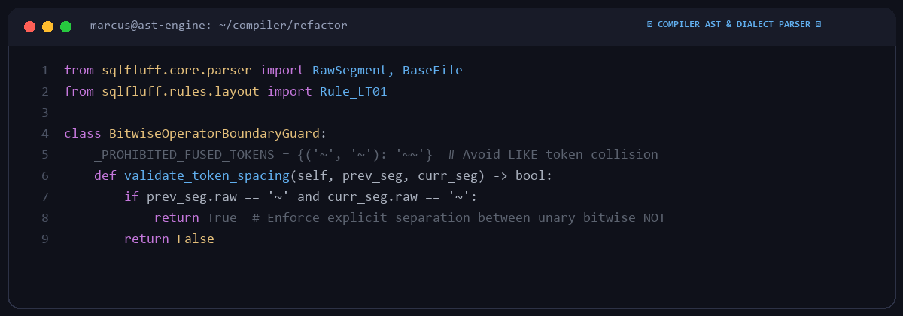

# Marcus Thorne

  

Compiler engineer & AST enthusiast located in Montreal, Canada.  
Working on dialect parsers, SQL linters, refactoring algorithms, and syntax tree transformations.

---

### ⚡ Selected Open Source Patches

| Target | Subsystem | Focus Area | Status |
|---|---|---|---|
| **[sqlfluff/sqlfluff](https://github.com/sqlfluff/sqlfluff)** | Reflow / Respace | Operator spacing and unary token boundary preservation | Active |
| **[agronholm/anyio](https://github.com/agronholm/anyio)** | Concurrency | Task group lifecycle and cancellation propagation | Contributor |

---

### 🔬 Engineering Standards

- **Grammar Invariants**: Preventing token fusion and syntax collisions across dialect-specific grammars.
- **Surgical AST Edits**: Minimizing parse-tree modifications to preserve original formatting intent.
- **Automated Validation**: Regression testing against broad dialect corpuses (PostgreSQL, BigQuery, Snowflake, ANSI).

---
*Compilers • Dialect Parsers • AST • Tree-sitter • Python*